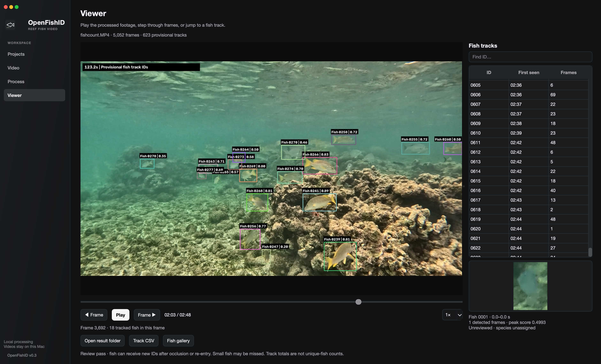

# OpenFishID

OpenFishID helps people explore fish life in underwater video. It brings fish detection, tracking and visual review into one desktop app, making reef footage easier to study for researchers, conservation teams, divers and anyone curious about marine life.

Videos are processed locally on your Mac, so your footage stays with you.

## What it offers

- **Find fish in video** with automated detection and provisional tracking.
- **Review sightings** with annotated playback, frame-by-frame viewing and a searchable fish list.
- **Explore the Fish Gallery** chronologically or in groups of similar-looking fish.
- **Improve underwater visibility** with adjustable color correction and preview comparisons.
- **Revisit projects** to explore previously processed footage.

## In development

OpenFishID is an early research tool for macOS. Detections and tracks need human review: fish may be missed, and the same fish can receive more than one track ID. Track totals are not counts of unique fish.

Visual similarity groups help with browsing; they do not identify species or confirm that sightings show the same individual. Automated species identification is planned for a future phase.

Current version: **0.4.0** · [Release history](CHANGELOG.md)

## Acknowledgements

OpenFishID builds on Community Fish Detector, YOLO, RF-DETR, BoT-SORT and DINOv2. Its interface styling draws on OpenReef, with attribution included in the project.
